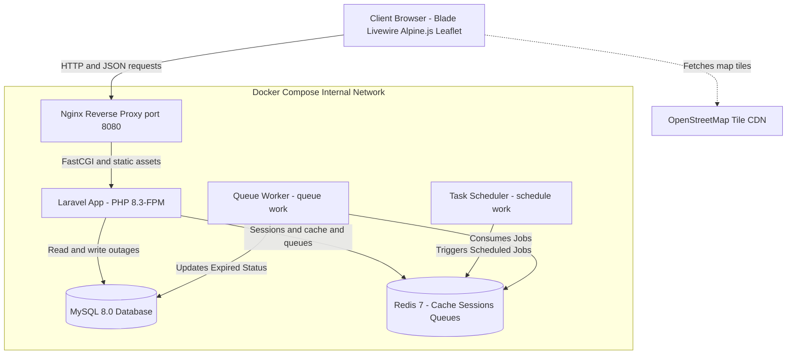
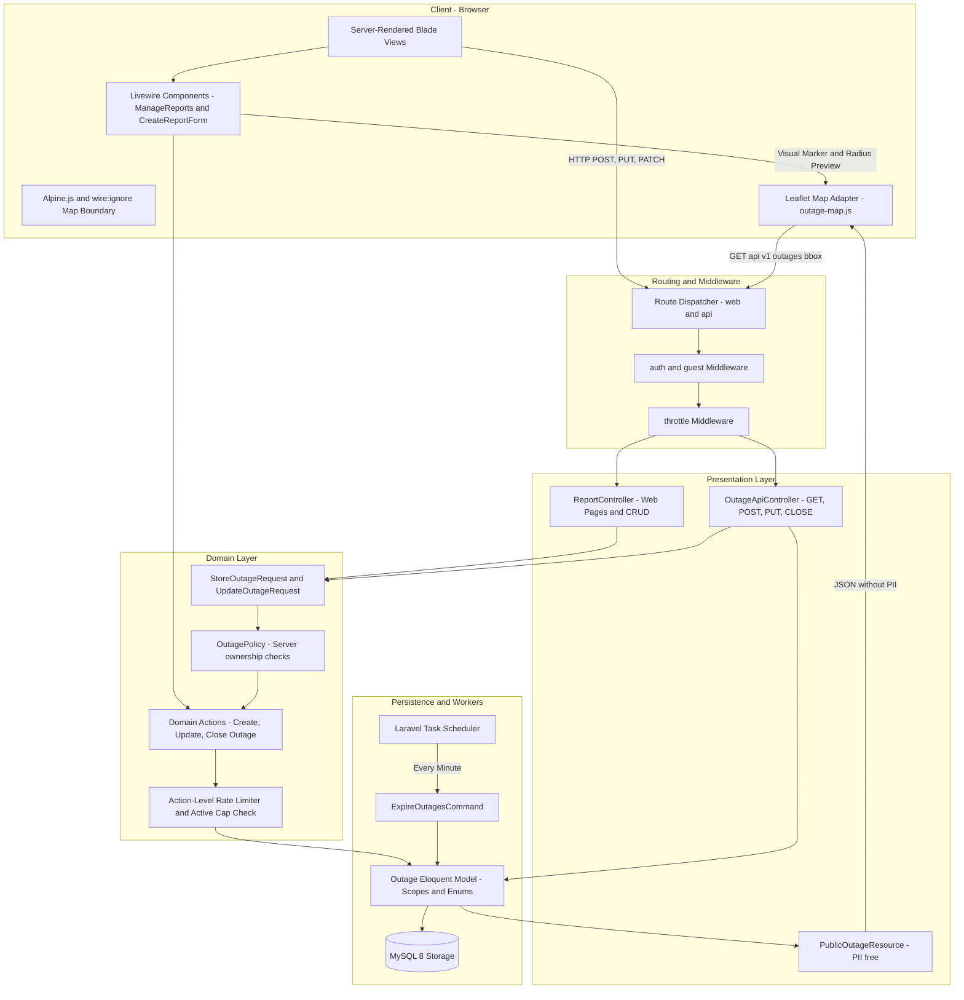
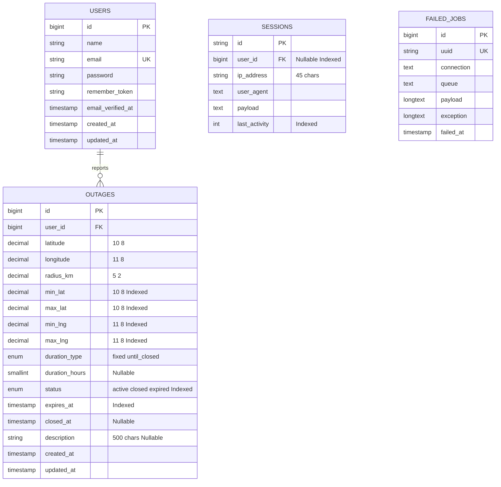
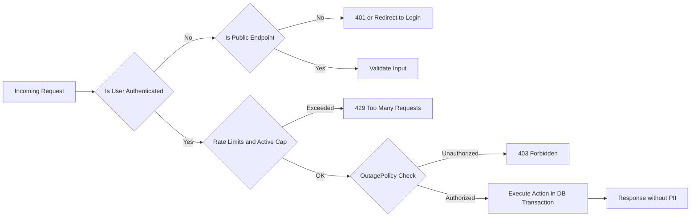
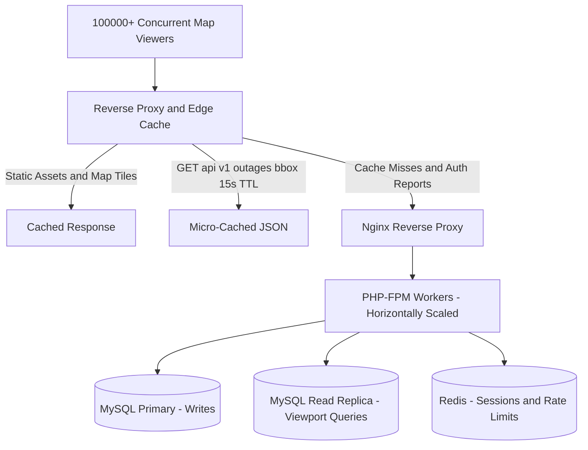

# System Architecture — Power Outage Reporting Platform

---

## 1. System Container Topology

The application runs as a containerized Laravel monolith orchestrated with Docker Compose. A single multi-stage Docker image powers the web runtime (PHP 8.3-FPM), queue workers, and task scheduler.



### Container Responsibilities

| Container | Base Image | Role |
|---|---|---|
| `nginx` | `nginx:1.27-alpine` | Serves compiled assets (`public/build`), terminates HTTP, and forwards PHP requests to FastCGI. |
| `app` | `php:8.3-fpm-alpine` | Runs the monolithic Laravel application as non-root `www-data`. |
| `queue` | Same as `app` | Processes asynchronous jobs (status updates, cleanup tasks). |
| `scheduler` | Same as `app` | Runs `php artisan schedule:work` every minute. |
| `db` | `mysql:8.0` | Relational database with composite bounding-box indexes and persistent volume. |
| `redis` | `redis:7-alpine` | Session storage, cache store, queue broker, and rate-limiting counters. |

---

## 2. Application Layer & Request Flow

The application separates presentation from domain logic. Controllers stay thin, delegating business rules to Action classes and authorization to Policies.



---

## 3. Data Model & Database Schema

The database schema isolates user credentials from outage reports. We precalculate and index bounding-box coordinates on creation to make viewport queries fast.



### Indexing Strategy

1. **`idx_outages_viewport` (`status`, `expires_at`, `min_lat`, `max_lat`, `min_lng`, `max_lng`)**: Composite index for bounding-box queries filtering active outages.
2. **`idx_outages_user_active` (`user_id`, `status`, `expires_at`)**: Fast lookup to enforce the maximum 3 active reports limit per user.
3. **`idx_outages_expiration` (`status`, `expires_at`)**: Used by the scheduler job to locate expired records that need a status update.

---

## 4. HTTP Surface & Domain Actions

### 4.1 Route Table

| URI | Method | Handler | Middleware | Auth | Description |
|---|---|---|---|---|---|
| `/` | `GET` | `LandingPageController` | `web` | No | Public landing page with embedded preview map. Returns HTTP 200. |
| `/map` | `GET` | `PublicMapController` | `web` | No | Fullscreen public outage map with auto-refresh. Returns HTTP 200. |
| `/reports/create` | `GET` | `ReportController@create` | `web`, `auth` | Yes | Outage submission page with map picker. Returns HTTP 200. |
| `/reports` | `POST` | `ReportController@store` | `web`, `auth` | Yes | Submit new report. Calls `CreateOutageAction` (rate limit of 5/hour enforced inside Action). |
| `/my-reports` | `GET` | `ReportController@index` | `web`, `auth` | Yes | User reports dashboard (paginated). Returns HTTP 200. |
| `/reports/{outage}/edit` | `GET` | `ReportController@edit` | `web`, `auth` | Yes | Edit report view. Verified by `OutagePolicy@update`. |
| `/reports/{outage}` | `PUT`, `PATCH` | `ReportController@update` | `web`, `auth` | Yes | Update active report. Calls `UpdateOutageAction`. |
| `/reports/{outage}/close` | `POST`, `PATCH` | `ReportController@close` | `web`, `auth` | Yes | Resolve outage manually. Calls `CloseOutageAction`. |
| `/api/v1/outages` | `GET` | `Api\V1\OutageApiController@index` | `throttle:outages-api` | No | Viewport JSON feed (`PublicOutageResource[]`, zero PII). |
| `/api/v1/outages` | `POST` | `Api\V1\OutageApiController@store` | `auth` | Yes | Create report via REST. Calls `CreateOutageAction` (rate limit of 5/hour enforced inside Action). |
| `/api/v1/outages/{outage}` | `PUT`, `PATCH` | `Api\V1\OutageApiController@update` | `auth` | Yes | Update report via REST. Calls `UpdateOutageAction`. |
| `/api/v1/outages/{outage}/close` | `POST`, `PATCH` | `Api\V1\OutageApiController@close` | `auth` | Yes | Resolve outage via REST. Calls `CloseOutageAction`. |
| `/login` | `GET`, `POST` | Breeze Auth | `web`, `guest`, `throttle:login` | No | Login form and credential validation. |
| `/register` | `GET`, `POST` | Breeze Auth | `web`, `guest`, `throttle:register` | No | Registration form and session creation. |
| `/logout` | `POST` | Breeze Auth | `web`, `auth` | Yes | Invalidate session, regenerate CSRF token, redirect to `/`. |

### 4.2 Domain Actions Layer

| Action | Responsibility | Authorization | Business Rules & Quotas | Side Effects |
|---|---|---|---|---|
| `CreateOutageAction` | Create new outage | Authenticated user | Max 3 active reports quota check; 72h safety cap for `until_closed`. | Computes bounding box; persists record with `status = active`. |
| `UpdateOutageAction` | Update active outage | `OutagePolicy@update` | Report must be currently active; 72h safety cap from creation. | Recalculates bounding box on radius change; updates record. |
| `CloseOutageAction` | Manually resolve outage | `OutagePolicy@close` | Report must be currently active (`expires_at > now()`). | Sets `status = closed` and `closed_at = now()`. |

### 4.3 Livewire Component Actions (State-Mutating)

| Livewire Component | Public Method | Invocation Trigger | Authorization | Domain Action Invoked | Reactive UI Effect |
|---|---|---|---|---|---|
| `App\Livewire\CreateReportForm` | `save()` | Form submit (`wire:submit="save"`) | `auth` | `CreateOutageAction` | Validates inputs, persists outage record, flashes session status, and redirects to `reports.index`. |
| `App\Livewire\ManageReports` | `openEditModal($outageId)` | Click "Edit" | `OutagePolicy@update` | None (reads model) | Loads outage attributes into component state and sets `showEditModal = true`. |
| `App\Livewire\ManageReports` | `updateReport()` | Modal submit (`wire:submit="updateReport"`) | `OutagePolicy@update` | `UpdateOutageAction` | Validates input, persists changes, closes modal, flashes status, and updates card. |
| `App\Livewire\ManageReports` | `closeReport($outageId)` / `resolve($outageId)` | Click "Mark as Resolved" (`wire:click`) | `OutagePolicy@close` | `CloseOutageAction` | Resolves outage, resets pagination (`resetPage`), flashes status, and moves card to history. |

---

## 5. Architecture Decision Records (ADRs)

### ADR 01: Session-Based Authentication (Laravel Breeze)
* **Status:** Accepted
* **Context:** The application is a Laravel monolith with server-rendered Blade layouts, reactive Livewire components, and Alpine.js. We need secure user authentication for managing outage reports.
* **Decision:** Use standard Laravel session cookies with the `web` guard via Laravel Breeze, with sessions stored in Redis.
* **Why:**
  - Token-based systems (JWT / Sanctum tokens) add unnecessary complexity (token refresh, client storage security) for a monolith.
  - Laravel's built-in session guard provides out-of-the-box protection against CSRF, session fixation (`session()->regenerate()`), and cookie hijacking (`HttpOnly`, `SameSite=Lax`).
  - Storing sessions in Redis keeps the PHP-FPM containers stateless so we can scale horizontally.
* **Trade-offs:** Requires Redis connectivity for session management; stateless API tokens are not used for browser actions.

---

### ADR 02: MySQL 8 with Precalculated Bounding-Box Columns
* **Status:** Accepted
* **Context:** The public map requests outages matching the user's visible viewport (bounding box). We need an efficient way to query these without causing high database CPU load.
* **Decision:** Use MySQL 8. When an outage is created or updated, precalculate its bounding box coordinates (`min_lat`, `max_lat`, `min_lng`, `max_lng`) based on its radius and store them in dedicated decimal columns with a composite B-tree index.
* **Calculation:**
  ```php
  // ~111.32 km per degree of latitude
  $deltaLat = $radiusKm / 111.32;
  $deltaLng = $radiusKm / (111.32 * cos(deg2rad($latitude)));

  $minLat = $latitude - $deltaLat;
  $maxLat = $latitude + $deltaLat;
  $minLng = $longitude - $deltaLng;
  $maxLng = $longitude + $deltaLng;
  ```
  The viewport query uses standard range comparisons:
  ```sql
  WHERE max_lat >= :viewport_min_lat
    AND min_lat <= :viewport_max_lat
    AND max_lng >= :viewport_min_lng
    AND min_lng <= :viewport_max_lng
  ```
* **Why:**
  - Running Haversine formulas (`ACOS/COS/SIN`) in SQL forces a full table scan on every map pan or zoom because computed expressions cannot use standard indexes efficiently.
  - PostGIS is powerful, but adding Postgres + PostGIS increases container size and configuration complexity for reviewers.
  - Precalculated bounding boxes give $O(\log N)$ range queries using standard MySQL composite indexes without external dependencies.
* **Trade-offs:** 4 extra decimal columns per row in exchange for fast, indexable reads.

---

### ADR 03: Dual-Layer Expiration Strategy
* **Status:** Accepted
* **Context:** Reports expire after a fixed duration (1–72 hours) or under "Until I close it" (with a mandatory 72-hour hard safety cap). Expired reports must *never* appear active on the public map, even if the scheduler or queue worker crashes or lags.
* **Decision:** Implement a dual-layer strategy:
  1. **Query Scope (Immediate Consistency):** Every query fetching active reports must enforce:
     ```php
     $query->where('status', OutageStatus::Active)
           ->where('expires_at', '>', now());
     ```
  2. **Background Scheduler (State Transition):** A scheduled command runs every minute to transition overdue records:
     ```php
     Outage::where('status', OutageStatus::Active)
           ->where('expires_at', '<=', now())
           ->update(['status' => OutageStatus::Expired]);
     ```
* **Why:** Relying solely on the background worker means that if the worker lags by 2 minutes, expired reports would still show as active. The query scope guarantees real-time accuracy regardless of background job status.
* **Trade-offs:** Queries check both `status` and `expires_at`, which is covered by our composite index (`status`, `expires_at`).

---

### ADR 04: Duplicate Reports Handling (Allow Overlaps with Visual Density)
* **Status:** Accepted
* **Context:** During an outage, multiple users in the same neighborhood will submit overlapping reports. We must decide how to handle them (destructive merging, blocking, or allowing overlaps).
* **Decision:** **Allow overlapping reports without merging. Display them as overlapping translucent circles on the map.**
* **Why:**
  - Automatically merging reports creates severe edge cases: Which description is kept? Whose expiration time takes priority? What happens if one user closes their report early?
  - Blocking overlapping reports prevents other users from reporting their specific street or situation.
  - Multiple overlapping reports provide useful visual signal: areas with higher report density naturally look darker on the map.
  - Each user keeps full ownership to edit or close their own report.
* **Trade-offs:** Concentrated blackouts will show stacked circles. We use translucent fill colors (`rgba(229, 72, 77, 0.15)`) with a clean 1.5px border (`#E5484D`) so overlapping layers blend clearly.

---

### ADR 05: Map Provider & Key Protection (Leaflet + OpenStreetMap)
* **Status:** Accepted
* **Context:** Evaluators need to run the application immediately without signing up for paid accounts or entering credit card details. The map provider must also be decoupled from the application views.
* **Decision:** Use **Leaflet.js with official OpenStreetMap tiles (`tile.openstreetmap.org`)** as the default provider, encapsulated behind a Blade component (`<x-outage-map />`) and a JavaScript adapter (`resources/js/outage-map.js`).
* **Why:**
  - Zero cost, 100% free, zero API keys, zero watermarks, and zero setup friction for anyone reviewing the repository.
  - Direct OpenStreetMap tiles (`https://tile.openstreetmap.org/{z}/{x}/{y}.png`) ensure reliable public serving without third-party API key enforcement or watermarks.
  - The JavaScript adapter pattern keeps Leaflet APIs out of views. If a project requires Google Maps in the future, only the adapter needs to be swapped.
  - If a Google Maps key is provided in `.env`, it is injected at runtime via Blade layout configuration (`config('services.maps.key')`), never baked into Vite bundles.
  - **Browser Key Hardening (Production):** If an external provider key is exposed in client-side HTML, exposure risk is mitigated directly in the provider's cloud console: (1) HTTP Referrer allowlisting locked to the production domain (`https://app.example.com/*`), (2) API scoping restricted exclusively to the Maps JavaScript API (disabling Geocoding, Places, or Elevation APIs on that credential), and (3) daily request quota caps with budget alerts to prevent bill-shock abuse.
* **Trade-offs:** Leaflet is 2D-only, which is completely sufficient for an outage circle map.

---

### ADR 06: Hybrid Frontend Architecture (Livewire 4 Reactive Components + Blade + Alpine.js + wire:ignore Leaflet Adapter)
* **Status:** Accepted
* **Context:** Interactive Leaflet maps require continuous DOM stability. Automated component morphing engines can inadvertently destroy Leaflet SVG/canvas instances, reset viewport state, and detach event listeners during re-renders. Meanwhile, interactive reporting, fast in-place pagination, status resolution, and report editing require reactive, single-page-like UX without full page reloads.
* **Decision:**
  - Adopt a robust hybrid architecture: use **Livewire 4** components (`CreateReportForm`, `ManageReports`) for reactive form handling, validation errors, real-time feedback, and AJAX-driven pagination using the `WithPagination` trait.
  - Isolate the Leaflet interactive map instances using Livewire's `wire:ignore` directive on the map container (`<div wire:ignore><div id="picker-map">...</div></div>`).
  - Use **Alpine.js** and modular JavaScript (`resources/js/outage-map.js`) for lightweight 60fps client-side map interactions (radius slider feedback, geolocation resolution, coordinate syncing).
  - Business logic, authorization, quota checks, and persistence are strictly delegated to server-side Domain Actions (`CreateOutageAction`, `UpdateOutageAction`, `CloseOutageAction`) and `OutagePolicy`.
* **Why:**
  - `wire:ignore` creates an impervious boundary around Leaflet, preventing DOM diffing from re-initializing the map or causing visual flickers.
  - Livewire provides seamless reactivity for user-facing tables, pagination, and modals without writing custom AJAX/fetch boilerplate.
  - Zero heavy SPA frameworks (no Vue or React dependencies required), honoring the Laravel Monolith constraint while achieving modern reactive UX.
* **Trade-offs:** Livewire properties and Leaflet coordinates are synchronized using DOM event listeners (`input`/`change`) within the component view.
* **Timezone Strategy (UTC Storage & Local Timezone Display):**
  - **Storage:** All datetime timestamps (`created_at`, `expires_at`, `closed_at`, `updated_at`) are saved in UTC in MySQL, preventing timezone desynchronization and daylight-saving bugs in database calculations.
  - **Transmission:** Dates rendered in HTML or emitted through JSON endpoints are transmitted as ISO-8601 UTC strings (`$outage->created_at->toIso8601String()`), formatted in views with semantic `<time datetime="..." data-utc="...">` elements alongside human-relative indicators (`diffForHumans()`).
  - **Client-Side Rendering:** The browser converts UTC timestamps into the user's local operating system timezone using native client-side APIs (`Date.toLocaleTimeString()` in Leaflet map popups and `Intl.DateTimeFormat` in table views), guaranteeing zero user-preference configuration overhead and eliminating server session timezone tracking.

---

### ADR 07: Public Map Data Retrieval via Dedicated JSON API
* **Status:** Accepted
* **Context:** The public map must load outages for the visible map area and update when users pan or zoom.
* **Decision:** Use a lightweight, versioned JSON endpoint: `GET /api/v1/outages?min_lat=...&min_lng=...&max_lat=...&max_lng=...`, queried directly by the map adapter using debounced `fetch()`.
* **Why:**
  - Map pan and zoom trigger frequent viewport changes. Handling these through full-page loads would cause excessive latency.
  - A REST controller with an Eloquent API Resource executes in milliseconds, uses minimal memory, and strips all personal data before output.
  - Enables HTTP client-side debouncing (300ms) and standard browser/reverse-proxy caching (`Cache-Control: public, max-age=15, stale-while-revalidate=30`).
* **Trade-offs:** Requires maintaining a dedicated API route and resource alongside web views.

---

## 6. Security Considerations



### 6.1 Guarding Against Request Parameter Tampering
- **Session-Based Ownership:** The reporting `user_id` is never accepted from client input or query strings. It is always resolved directly from `auth()->id()`.
- **Policy Enforcement on Every Mutation:** Before updating or closing a report, actions call `Gate::authorize('update', $outage)` and `Gate::authorize('close', $outage)`. Tampering with an ID to modify someone else's outage immediately returns an HTTP 403 Forbidden.

### 6.2 Application-Level Rate Limiting & Active Report Caps
- **Domain Action-Level Rate Limiting:** As highlighted in Section 4.6 of the specification, route middleware alone cannot intercept Livewire component actions executing through internal endpoints (`POST /livewire/update`). To guarantee that rate limits cannot be bypassed through client-side component tampering, the rate limit (5 reports/hour, configurable via `OUTAGE_RATE_LIMIT_PER_HOUR`) is enforced directly inside `CreateOutageAction::execute()` using `RateLimiter::tooManyAttempts("create-outage:{$user->id}", $max)`. If exceeded, a `ValidationException` with status 429 is thrown. Upon successful database creation, `RateLimiter::hit()` increments the counter with a 3600-second TTL. This establishes `CreateOutageAction` as the single source of truth across Web forms, Livewire actions, and REST API endpoints.
- **Active Reports Limit:** Inside `CreateOutageAction`, the system checks:
  ```php
  $activeCount = Outage::where('user_id', $user->id)
      ->active()
      ->count();

  if ($activeCount >= config('outage.max_active_per_user', 3)) {
      throw ValidationException::withMessages([
          'outage' => "You have reached the maximum limit of {$maxActive} active reports.",
      ]);
  }
  ```

### 6.3 Preventing Personal Data Leakage (PII)
- The public map endpoint uses `PublicOutageResource`, which exposes only: `id`, `latitude`, `longitude`, `radius_km`, `bounding_box`, `status`, `duration_type`, `duration_hours`, `expires_at`, `closed_at`, `created_at`, `description`, and a boolean `is_owner`.
- `user_id`, user names, emails, and IP addresses are completely excluded.
- Blade views and Livewire components for guest users do not pass user models into Alpine or inline script tags.

---

## 7. Scalability Considerations (Blackout Surge Scenario)

During a major blackout, thousands of residents check the map simultaneously. The architecture handles this spike as follows:



1. **Decoupled Viewport Queries:** Serving map data via `GET /api/v1/outages` allows passive viewers to fetch updates without writing sessions or running heavy overhead.
2. **HTTP Micro-Caching:** Responses from `/api/v1/outages` include `Cache-Control: public, max-age=15, stale-while-revalidate=30`. During a spike, identical viewport requests from the same city are served from cache, reducing database queries by over 90%.
3. **Database Read/Write Splitting:** Read queries for bounding-box coordinates can be routed to MySQL read replicas, keeping the primary database free for report submissions and status updates.
4. **Independent Queue Workers:** Expiration cleanup and background commands run in isolated worker containers, ensuring web request response times remain unaffected by background tasks.
