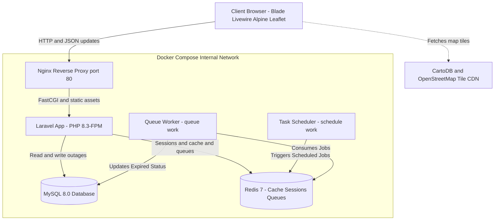
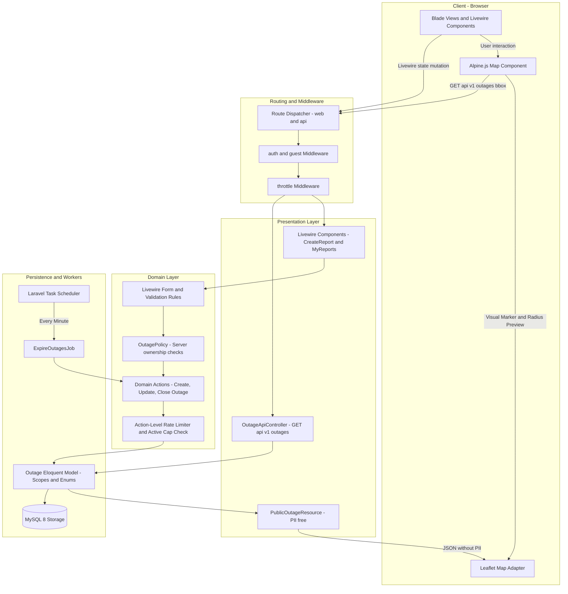
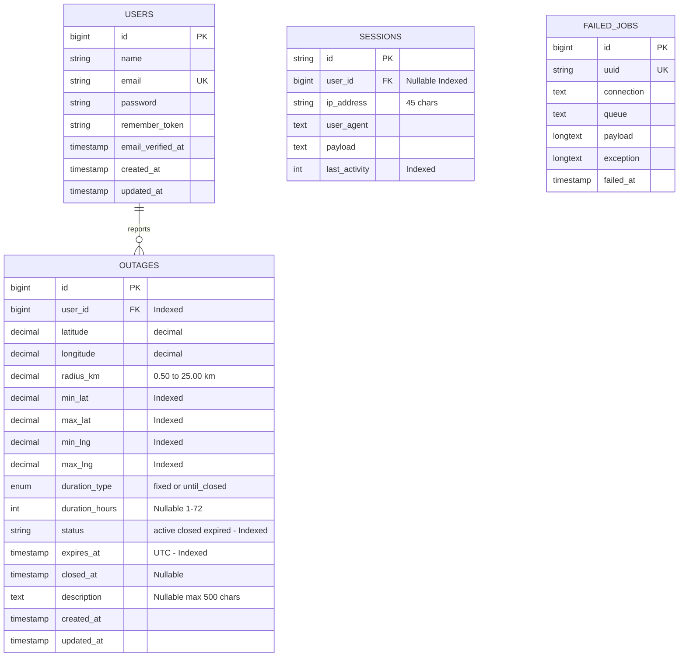
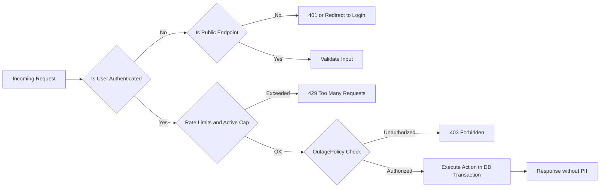
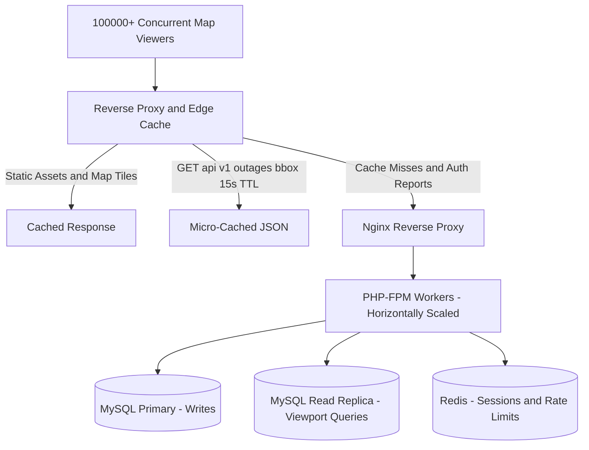

# System Architecture — Power Outage Reporting Platform

---

## 1. System Container Topology

The application runs as a containerized Laravel monolith orchestrated with Docker Compose. A single multi-stage Docker image powers the web runtime (PHP 8.3-FPM), queue workers, and task scheduler.



### Container Responsibilities

| Container | Base Image | Role |
|---|---|---|
| `nginx` | `nginx:alpine` | Serves compiled assets (`public/build`), terminates HTTP, and forwards PHP requests to FastCGI. |
| `app` | `php:8.3-fpm-alpine` | Runs the monolithic Laravel application as non-root `www-data`. |
| `queue` | Same as `app` | Processes asynchronous jobs (status updates, cleanup tasks). |
| `scheduler` | Same as `app` | Runs `php artisan schedule:work` every minute. |
| `db` | `mysql:8.0` | Relational database with composite bounding-box indexes and persistent volume. |
| `redis` | `redis:7-alpine` | Session storage, cache store, queue broker, and rate-limiting counters. |

---

## 2. Application Layer & Request Flow

The application separates presentation from domain logic. Controllers and Livewire components stay thin, delegating business rules to Action classes and authorization to Policies.



---

## 3. Data Model & Database Schema

The database schema isolates user credentials from outage reports. We precalculate and index bounding-box coordinates on creation to make viewport queries fast.



### Indexing Strategy

1. **`idx_outages_viewport` (`status`, `expires_at`, `min_lat`, `max_lat`, `min_lng`, `max_lng`)**: Composite index for bounding-box queries filtering active outages.
2. **`idx_outages_user_active` (`user_id`, `status`, `expires_at`)**: Fast lookup to enforce the maximum 3 active reports limit per user.
3. **`idx_outages_expiration` (`status`, `expires_at`)**: Used by the scheduler job to locate expired records that need a status update.

---

## 4. HTTP Surface & Livewire Actions

### 4.1 Route Table

| URI | Method | Handler | Middleware | Auth | Description |
|---|---|---|---|---|---|
| `/` | `GET` | `LandingPageController` | `web` | No | Public landing page with embedded map. Returns HTTP 200. |
| `/map` | `GET` | `PublicMapController` | `web` | No | Fullscreen public outage map. Returns HTTP 200. |
| `/api/v1/outages` | `GET` | `Api\V1\OutageApiController@index` | `api`, `throttle:60,1` | No | Viewport JSON feed (`PublicOutageResource[]`, zero PII). |
| `/reports/create` | `GET` | `Pages\Reports\CreateReport` | `web`, `auth` | Yes | Outage submission page (Livewire). Returns HTTP 200. |
| `/my-reports` | `GET` | `Pages\Reports\MyReports` | `web`, `auth` | Yes | User reports dashboard (Livewire, paginated). Returns HTTP 200. |
| `/login` | `GET`, `POST` | Breeze / Fortify Auth | `web`, `guest`, `throttle:login` | No | Login form and credential validation. |
| `/register` | `GET`, `POST` | Breeze / Fortify Auth | `web`, `guest`, `throttle:register` | No | Registration form and session creation. |
| `/logout` | `POST` | Breeze / Fortify Auth | `web`, `auth` | Yes | Invalidate session, regenerate CSRF token, redirect to `/`. |

### 4.2 State-Mutating Livewire Actions

| Component | Action | Authorization | Checks & Limits | Side Effects |
|---|---|---|---|---|
| `CreateReport` | `save()` | Authenticated user | 5 reports/hr limit + max 3 active reports | Calls `CreateOutageReportAction`, redirects to `/my-reports`. |
| `MyReports` | `editReport($id)` | `OutagePolicy@update` | Report must be active | Loads record into the edit modal state. |
| `MyReports` | `updateReport()` | `OutagePolicy@update` | Validates radius, duration, description | Calls `UpdateOutageReportAction`, refreshes table. |
| `MyReports` | `closeReport($id)` | `OutagePolicy@close` | Report must be active | Calls `CloseOutageReportAction`, marks `closed_at = now()`. |

---

## 5. Architecture Decision Records (ADRs)

### ADR 01: Session-Based Authentication (Laravel Breeze / Fortify)
* **Status:** Accepted
* **Context:** The application is a monolith with server-rendered Blade templates and Livewire. We need secure user authentication for managing outage reports.
* **Decision:** Use standard Laravel session cookies with the `web` guard (via Laravel Breeze or Fortify), with sessions stored in Redis.
* **Why:** 
  - Token-based systems (JWT / Sanctum tokens) add unnecessary complexity (token refresh, client storage security) for a monolith.
  - Laravel's built-in session guard provides out-of-the-box protection against CSRF, session fixation (`session()->regenerate()`), and cookie hijacking (`HttpOnly`, `SameSite=Lax`).
  - Storing sessions in Redis keeps the PHP-FPM containers stateless so we can scale horizontally.
* **Trade-offs:** Requires Redis connectivity for session management; stateless API tokens are not used for browser actions.

---

### ADR 02: MySQL 8 with Precalculated Bounding-Box Columns
* **Status:** Accepted
* **Context:** The public map requests outages matching the user's visible viewport (bounding box). We need an efficient way to query these without causing high database CPU load.
* **Decision:** Use MySQL 8. When an outage is created or updated, precalculate its bounding box coordinates (`min_lat`, `max_lat`, `min_lng`, `max_lng`) based on its radius and store them in dedicated decimal columns with a composite B-tree index.
* **Calculation:**
  ```php
  // ~111.32 km per degree of latitude
  $deltaLat = $radiusKm / 111.32;
  $deltaLng = $radiusKm / (111.32 * cos(deg2rad($latitude)));

  $minLat = $latitude - $deltaLat;
  $maxLat = $latitude + $deltaLat;
  $minLng = $longitude - $deltaLng;
  $maxLng = $longitude + $deltaLng;
  ```
  The viewport query uses standard range comparisons:
  ```sql
  WHERE max_lat >= :viewport_min_lat
    AND min_lat <= :viewport_max_lat
    AND max_lng >= :viewport_min_lng
    AND min_lng <= :viewport_max_lng
  ```
* **Why:**
  - Running Haversine formulas (`ACOS/COS/SIN`) in SQL forces a full table scan on every map pan or zoom because computed expressions cannot use standard indexes efficiently.
  - PostGIS is powerful, but adding Postgres + PostGIS increases container size and configuration complexity for reviewers.
  - Precalculated bounding boxes give $O(\log N)$ range queries using standard MySQL composite indexes without external dependencies.
* **Trade-offs:** 4 extra decimal columns per row in exchange for fast, indexable reads.

---

### ADR 03: Dual-Layer Expiration Strategy
* **Status:** Accepted
* **Context:** Reports expire after a fixed duration (1–72 hours) or under "Until I close it" (with a mandatory 72-hour hard safety cap). Expired reports must *never* appear active on the public map, even if the scheduler or queue worker crashes or lags.
* **Decision:** Implement a dual-layer strategy:
  1. **Query Scope (Immediate Consistency):** Every query fetching active reports must enforce:
     ```php
     $query->where('status', OutageStatus::Active)
           ->where('expires_at', '>', now());
     ```
  2. **Background Scheduler (State Transition):** A scheduled command runs every minute to transition overdue records:
     ```php
     Outage::where('status', OutageStatus::Active)
           ->where('expires_at', '<=', now())
           ->update(['status' => OutageStatus::Expired]);
     ```
* **Why:** Relying solely on the background worker means that if the worker lags by 2 minutes, expired reports would still show as active. The query scope guarantees real-time accuracy regardless of background job status.
* **Trade-offs:** Queries check both `status` and `expires_at`, which is covered by our composite index (`status`, `expires_at`).

---

### ADR 04: Duplicate Reports Handling (Allow Overlaps with Visual Density)
* **Status:** Accepted
* **Context:** During an outage, multiple users in the same neighborhood will submit overlapping reports. We must decide how to handle them (destructive merging, blocking, or allowing overlaps).
* **Decision:** **Allow overlapping reports without merging. Display them as overlapping translucent circles on the map.**
* **Why:**
  - Automatically merging reports creates severe edge cases: Which description is kept? Whose expiration time takes priority? What happens if one user closes their report early?
  - Blocking overlapping reports prevents other users from reporting their specific street or situation.
  - Multiple overlapping reports provide useful visual signal: areas with higher report density naturally look darker on the map.
  - Each user keeps full ownership to edit or close their own report.
* **Trade-offs:** Concentrated blackouts will show stacked circles. We use translucent fill colors (`rgba(229, 72, 77, 0.15)`) with a clean 1.5px border (`#E5484D`) so overlapping layers blend clearly.

---

### ADR 05: Map Provider & Key Protection (Leaflet + OpenStreetMap)
* **Status:** Accepted
* **Context:** Evaluators need to run the application immediately without signing up for paid accounts or entering credit card details. The map provider must also be decoupled from the application views.
* **Decision:** Use **Leaflet.js with CartoDB Positron / OpenStreetMap tiles** as the default provider, encapsulated behind a Blade component (`<x-outage-map />`) and a JavaScript adapter (`resources/js/map/OutageMapAdapter.js`).
* **Why:**
  - Zero cost, zero API keys, and zero setup friction for anyone reviewing the repository.
  - CartoDB Positron's clean, light grayscale style matches our minimalist UI guidelines (`#FFFFFF`, `#111111`, `#E5484D`).
  - The JavaScript adapter pattern keeps Leaflet APIs out of Livewire and Blade. If a project requires Google Maps in the future, only the adapter needs to be swapped.
  - If a Google Maps key is provided in `.env`, it is injected at runtime via Blade layout configuration (`config('services.maps.key')`), never baked into Vite bundles.
  - **Browser Key Hardening (Production):** If an external provider key is exposed in client-side HTML, exposure risk is mitigated directly in the provider's cloud console: (1) HTTP Referrer allowlisting locked to the production domain (`https://app.example.com/*`), (2) API scoping restricted exclusively to the Maps JavaScript API (disabling Geocoding, Places, or Elevation APIs on that credential), and (3) daily request quota caps with budget alerts to prevent bill-shock abuse.
* **Trade-offs:** Leaflet is 2D-only, which is completely sufficient for an outage circle map.

---

### ADR 06: Frontend Integration (Livewire + Alpine.js + Leaflet)
* **Status:** Accepted
* **Context:** Livewire's DOM morphing can destroy JavaScript map instances and drop event listeners during component re-renders. Additionally, adjusting the radius slider must update the map instantly without server latency, and server-rendered views must display dates in the user's local timezone.
* **Decision:**
  - Mark the map container with `wire:ignore`.
  - Let an Alpine.js component (`x-data="outageMap(...)"`) manage the map lifecycle, Leaflet instance, and marker/circle drawing.
  - Handle radius slider changes purely on the client in Alpine.js for instant 60fps feedback.
  - Sync coordinates and radius to Livewire using `$wire.set(...)` or browser events when the user finishes adjusting them.
  - **SSR Timezone Strategy:** All timestamps are stored in UTC in the database. In the browser, Alpine.js resolves the user's local timezone using `Intl.DateTimeFormat().resolvedOptions().timeZone` to render formatted times client-side, while syncing that IANA timezone string into the user's Laravel session (via cookie or initial lightweight sync) so server-rendered Blade templates can localize timestamps using Carbon (`$date->setTimezone(session('timezone'))`).
* **Why:** Prevents map flickering or re-initialization when Livewire re-renders validation errors or flash messages. Keeps the slider interaction smooth and ensures dates match the user's wall clock regardless of server timezone.
* **Trade-offs:** Coordinate validation exists in both client-side JavaScript (for map limits) and server-side PHP Form Requests (for security).

---

### ADR 07: Public Map Data Retrieval via Dedicated JSON API
* **Status:** Accepted
* **Context:** The public map must load outages for the visible map area and update when users pan or zoom. We could fetch this data through Livewire actions or through a dedicated JSON endpoint.
* **Decision:** Use a lightweight, versioned JSON endpoint: `GET /api/v1/outages?bbox=minLat,minLng,maxLat,maxLng`, queried directly by the map adapter using `fetch()`.
* **Why:**
  - Map pan and zoom trigger frequent viewport changes. Handling these through Livewire would trigger full component lifecycle rehydration, encrypting and sending component payloads on every move.
  - A REST controller with an Eloquent API Resource executes in milliseconds, uses minimal memory, and strips all personal data before output.
  - Enables HTTP client-side debouncing (300ms) and standard browser/reverse-proxy caching (`Cache-Control: public, max-age=15`).
* **Trade-offs:** Requires maintaining a dedicated API route and controller alongside Livewire components.

---

## 6. Security Considerations



### 6.1 Guarding Against Livewire Payload Tampering
In Livewire, request payloads sent to `/livewire/update` can be modified by the client. We enforce:
- **Session-Based Ownership:** The reporting `user_id` is never accepted from component properties or client parameters. It is always resolved directly from `auth()->id()`.
- **Policy Enforcement on Every Mutation:** Before updating or closing a report, actions call `Gate::authorize('update', $outage)` and `Gate::authorize('close', $outage)`. Tampering with an ID to modify someone else's outage immediately returns an HTTP 403 Forbidden.

### 6.2 Application-Level Rate Limiting & Active Report Caps
Middleware alone is not enough because Livewire requests hit a single `/livewire/update` route. We enforce limits inside the domain layer:
- **Rate Limiting:** Inside `CreateOutageReportAction`, we use Laravel's `RateLimiter::attempt()` keyed by user ID (5 reports/hour).
- **Active Reports Limit:** Before creating a report, the action checks:
  ```php
  $activeCount = Outage::where('user_id', $user->id)
      ->where('status', OutageStatus::Active)
      ->where('expires_at', '>', now())
      ->count();

  if ($activeCount >= config('outages.max_active_per_user', 3)) {
      throw new ActiveOutageLimitExceededException();
  }
  ```

### 6.3 Preventing Personal Data Leakage (PII)
- The public map endpoint uses `PublicOutageResource`, which exposes only: `id`, `latitude`, `longitude`, `radius_km`, `status`, `expires_at`, `duration_type`, and `description`.
- `user_id`, user names, emails, IP addresses, and timestamps other than start/expiration are completely excluded.
- Blade views for guest users do not pass user models into Alpine or inline script tags.

---

## 7. Scalability Considerations (Blackout Surge Scenario)

During a major blackout, thousands of residents check the map simultaneously. The architecture handles this spike as follows:



1. **Decoupled Viewport Queries:** Serving map data via `GET /api/v1/outages` instead of Livewire means passive viewers do not trigger Livewire hydration or session writes.
2. **HTTP Micro-Caching:** Responses from `/api/v1/outages` include `Cache-Control: public, max-age=15, stale-while-revalidate=30`. During a spike, identical viewport requests from the same city are served from cache, reducing database queries by over 90%.
3. **Database Read/Write Splitting:** Read queries for bounding-box coordinates can be routed to MySQL read replicas, keeping the primary database free for report submissions and status updates.
4. **Independent Queue Workers:** Expiration cleanup and notifications run in background workers, ensuring web request response times remain unaffected by background tasks.
